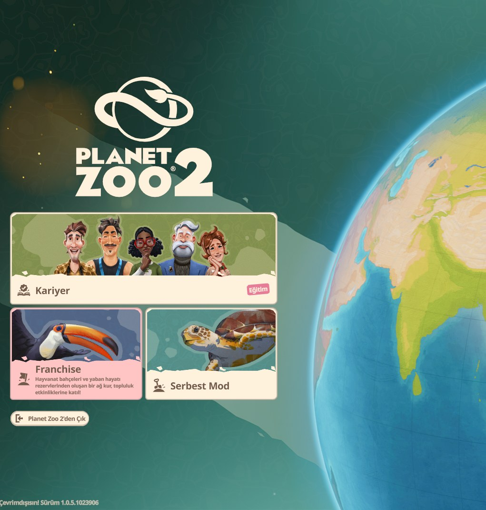
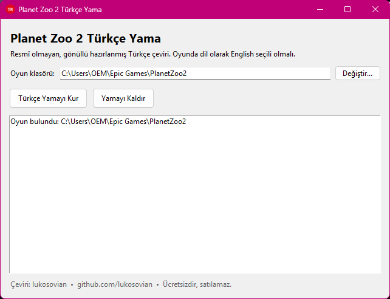

# Planet Zoo 2 Türkçe Yama

Planet Zoo 2 için gönüllü olarak hazırlanmış, **resmî olmayan** Türkçe dil yaması.

> Bu proje Frontier Developments ile bağlantılı değildir ve onlar tarafından onaylanmamıştır.
> Planet Zoo, Frontier Developments plc'nin ticari markasıdır.

**[⬇ PZ2TurkceYama.exe dosyasını indir](../../releases/latest)** — tek tıkla kurulur, Python ya da başka bir program gerekmez.

  
  

## Neler çevrildi?

Oyundaki çevrilmesi gereken metinlerin tamamı (31.254 metin) Türkçeye çevrildi:

- Ana menü, arayüz, ayarlar ve bildirimler
- Kariyer, senaryolar, görevler ve diyaloglar
- Zoopedia (tüm tür bilgileri), eğitim konuları, yardım makaleleri
- Ziyaretçi düşünceleri, personel ve hayvan bilgileri
- İnşa nesneleri, dekorlar, bitkiler, şablonlar

Bilerek çevrilmeyenler: hayvan ve ziyaretçi adları, bilimsel adlar, lisans/EULA metinleri ve emeği geçenler listesi.

Çeviride makine çevirisi havası değil, doğal bir yerelleştirme hedeflendi: "sen" diliyle hitap, tutarlı terimler
(örneğin Ride = Araç, Keeper = Bakıcı, Exhibit = Sergi) ve metrik birimler. Oyundaki değişkenler (`{...}` gibi)
otomatik olarak denetlenir, bu yüzden yama oyunda metin bozulmasına yol açmaz.

## Nasıl çalışır?

Türkçe, oyunda ayrı bir dil olarak görünmez. Yama, oyunun **İngilizce** dil dosyasının içine Türkçe metinleri yazar.
Bu yüzden oyunda dil olarak **English** seçili olmalı.

Bu depoda Frontier'a ait oyun dosyaları **yoktur**. Kurulum aracı, yamayı senin bilgisayarındaki oyun dosyasından üretir.
Orijinal dosya yedeklenir ve istediğin zaman geri yüklenebilir.

## Kurulum

1. **[Releases](../../releases/latest)** sayfasından `PZ2TurkceYama.exe` dosyasını indir.
2. Oyunu kapat ve `PZ2TurkceYama.exe` dosyasını çalıştır.
3. Program oyunun klasörünü kendisi bulur (Epic Games ve Steam). Bulamazsa **Değiştir...** ile
   `PlanetZoo2.exe` dosyasının olduğu klasörü seç.
4. **Türkçe Yamayı Kur** düğmesine bas. Kurulum birkaç saniye sürer.
5. Oyunda dil olarak **English** seçili olduğundan emin ol.

Python ya da başka bir program kurmana gerek yok.

> Windows SmartScreen "tanınmayan uygulama" uyarısı gösterebilir. Bu, program imzasız olduğu içindir:
> **Ek bilgi → Yine de çalıştır** ile devam edebilirsin.

### Kaldırma

Aynı programı açıp **Yamayı Kaldır** düğmesine bas. Oyunun orijinal dil dosyası geri yüklenir.
Yedekler `%LOCALAPPDATA%\PZ2TurkceYama` klasöründe tutulur.

### Oyun güncellendiğinde

Oyun güncellemesi dil dosyasını sıfırlayabilir. Programı tekrar çalıştırıp **Türkçe Yamayı Kur** demen yeterli.
Güncellemeyle değişen ya da yeni gelen metinler, yamanın yeni sürümü çıkana kadar İngilizce görünür.

## Depoda neler var?

| Dosya | Açıklama |
|---|---|
| `release/tr_data.json.gz` | Türkçe çeviriler. İngilizce metinler yoktur; her satır için yalnızca İngilizce metnin kısa bir parmak izi saklanır. |
| `installer/kurulum.py` | Kurulum programının kaynak kodu. |
| `tools/fastloc.py` | Oyunun dil dosyasını okuyup yazan kısım ([cobra-tools](https://github.com/OpenNaja/cobra-tools) kullanır). |
| `installer/build_exe.py` | `PZ2TurkceYama.exe` dosyasını kaynak koddan üretir. |
| `STYLE_GUIDE.md`, `glossary.json` | Çeviri kuralları ve terim sözlüğü. |

Güncelleme sonrası metin değişirse parmak izi eşleşmez ve o satır İngilizce kalır; böylece eski bir çeviri yanlış yere yazılmaz.

## Katkıda bulunma

Hatalı ya da kulağa garip gelen bir çeviri gördüysen bir *issue* açabilirsin. Lütfen metnin oyunda nerede göründüğünü
ve önerdiğin çeviriyi yaz.

Çeviri kuralları için [STYLE_GUIDE.md](STYLE_GUIDE.md), terimler için [glossary.json](glossary.json) dosyasına bak.

## Teşekkürler

- Hazırlayan: [lukosovian](https://github.com/lukosovian)
- Dil dosyalarını açmak için [cobra-tools](https://github.com/OpenNaja/cobra-tools) kullanıldı.

## Lisans

- Kurulum programının kodu: [GNU GPL v3](LICENSE) (cobra-tools ile aynı lisans).
- Türkçe çeviri metinleri: [CC BY-NC-SA 4.0](https://creativecommons.org/licenses/by-nc-sa/4.0/deed.tr) —
  kaynak göstererek ve ticari olmayan amaçla paylaşabilir, uyarlayabilirsin.

Yama ücretsizdir ve öyle kalacak.
